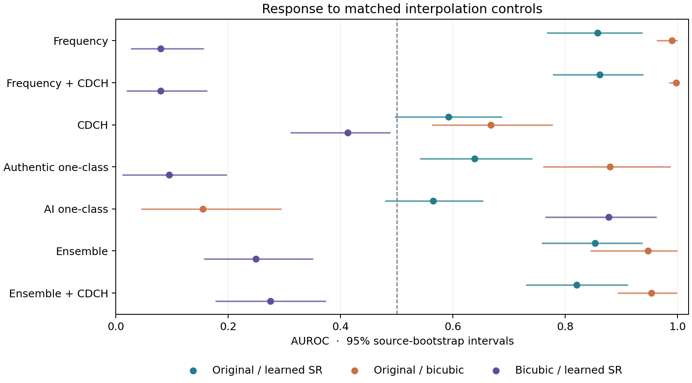
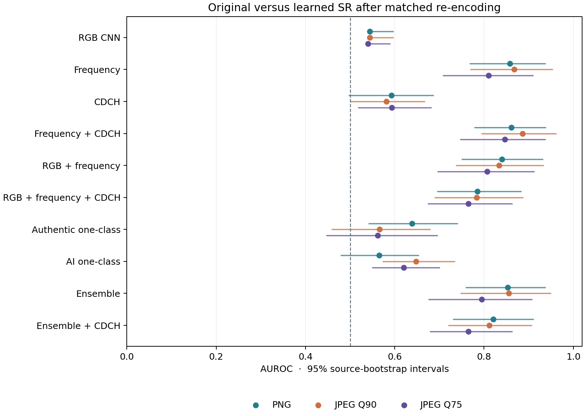
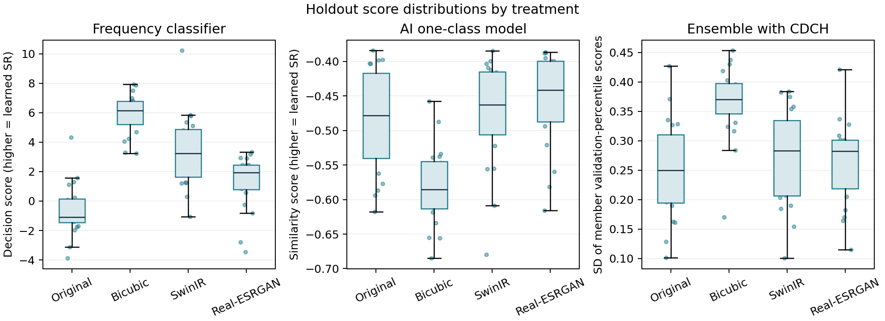

# Do super-resolution artifacts transfer to deepfake detection?

**Research pilot · November 16, 2026**

## Abstract

We investigated whether image classifiers trained on photographic reference crops and learned super-resolution (SR) reconstructions identify a signal distinguishable from ordinary resampling. We used 100 DIV2K sources, one bicubic control and two pretrained x2 upscalers. On 20 held-out sources, a frequency classifier achieved 0.858 AUROC (95% source-bootstrap interval 0.767–0.938) for original versus learned SR. The same score achieved 0.990 AUROC for original versus bicubic and 0.080 when learned SR was positive against bicubic. CDCH descriptors generated by Muzyka’s canonical JavaScript changed the frequency classifier’s original-versus-learned-SR AUROC by +0.004 (paired 95% interval −0.029 to +0.035). A one-class model fitted to learned reconstructions scored learned SR above bicubic more consistently, with AUROC 0.877 on that contrast and 0.565 against originals. The in-domain findings establish a strong response to the particular degradation pipeline. Zero-shot transfer to deepfakes remains unmeasured.

## 1. Related work and research gap

DIV2K provides reference images and synthetic degradations under known scale factors [1], [2]. RealSR and DRealSR supply paired camera observations under more varied optical degradations [3], [4]. This distinction matters because a classifier can identify the low-pass and interpolation signatures introduced by the benchmark pipeline. Using identical low-resolution inputs for an interpolator and two pretrained SR systems creates a controlled test of this alternative. SwinIR uses shifted-window attention and pixel shuffle in the selected checkpoint [7]. Real-ESRGAN uses a residual dense network and a degradation model designed for real-world restoration [8]. Both consume the same image content and LR grid in the pilot.

Cross-generator studies found that detectors trained on synthetic images can generalize under some training conditions [9], [13]. Spectral studies identify artifacts in specific generation mechanisms and distributions [10], [11]. This evidence motivates a frequency ablation. It leaves open the direction and size of transfer from reconstructions to face manipulations, where the manipulated region can be small and recompressed with authentic surroundings.

The closest precedent we found is He *et al.* [12]. They use auxiliary re-synthesis tasks, including SR, to build residual representations for generated-image classification. The discriminative problem here labels ordinary source photos and their own learned SR reconstructions, then applies that decision rule directly to a real-versus-deepfake benchmark. The label construction and use of residuals differ, so [12] provides mechanistic context and no direct measurement of the proposed transfer. Melnyk and Muzyka used circular distributed cumulative histograms for image inspection in PCB data [14]. Their result motivates the descriptor without establishing forensics performance.

FaceForensics++ and Celeb-DF v2 differ in collection and manipulation characteristics [15], [16]. DeepfakeBench standardizes preprocessing and comparisons for conventional detectors [17]. Its supervised Xception checkpoint is an appropriate external reference on identical target crops. Self-Blended Images synthesizes face-blending examples from authentic images for detector training [18]. It is a relevant proxy-supervision comparison with a face-manipulation-oriented training task. Published values from these papers are kept outside the SR pilot table because this study has no corresponding common-cohort target scores.

## 2. Materials and methods

**Sources and split.** We used all 100 images from the official DIV2K validation HR archive [2]. A fixed permutation assigned 60 sources to training, 20 to validation, and 20 to holdout. Source IDs and file hashes are in the manifests. These splits are internal to the pilot. The published lightweight SwinIR configuration uses DIV2K's published training set, so the pilot uses source IDs outside that explicitly declared split [7]. Near duplicates and the precise image-level composition of all upstream pretraining corpora were outside the audit.

**Pair construction.** After EXIF orientation and conversion to RGB, we took one 160 × 160 central context crop, downsampled it to 80 × 80 with Pillow bicubic, and generated bicubic, SwinIR-S x2 and RealESRGAN_x2plus outputs. The central 128 × 128 crop of the reference and each x2 output served as the classifier input, giving an 8-LR-pixel context margin before cropping. The LR file remains available for audit at its original generated size. RGB outputs were clipped, rounded to uint8 and saved with the same PNG encoding settings and no inherited metadata. All 100 source or reference pixel hashes were unique within their respective sets. The package includes exact model, code, and dataset asset hashes.

**Models.** The RGB baseline uses a small PyTorch CNN trained with binary cross-entropy and validation-AUROC epoch selection. The frequency baseline is standardized logistic regression over windowed luma FFT power in 16 radial bins and eight narrow axial bands. Two Isolation Forests fit either originals or learned reconstructions and apply fixed orientations to their similarity scores. Additional frequency models fit one upscaler at a time. CDCH generation executes the unmodified, checksum-verified Muzyka JavaScript at the geometric center in 360 one-degree directions. Python summarizes the 360 × 256 cumulative matrices with per-threshold directional means, dispersion, adjacent-angle changes, and low-to-high angular modes. Standardized logistic regression used CDCH alone and CDCH concatenated with frequency features. RGB/frequency/CDCH combinations average validation-percentile member scores with fixed equal weights according to the saved protocol.

**Scoring.** All learned-SR binary training used originals and the two learned-reconstruction treatments. Bicubic was only a held-out diagnostic. Validation selected thresholds by balanced accuracy, with the higher threshold used for ties. We report AUROC, stepwise AUPRC (average precision), balanced accuracy, and confusion matrices. A grouped percentile bootstrap with 1,000 draws sampled source IDs and retained each sampled source’s full set of evaluated treatments. Paired model differences reuse bootstrap draws. Within-source ordering removes comparisons between unrelated image contents. AUROC and balanced accuracy have 0.5 chance references. The precision–recall reference is positive prevalence, 2/3 for the combined learned-SR comparison and 1/2 for individual comparisons. The JPEG perturbations encode and decode each variant at the same quality with 4:2:0 subsampling. The model and threshold are unchanged for these evaluations.

## 3. Results

### 3.1 Interpolation and upscaler controls

| Frequency model and contrast, PNG | AUROC | Interpretation of positive score direction |
|---|---:|---|
| Originals vs. learned SR | 0.858 | Learned SR tended to rank above originals |
| Originals vs. bicubic | 0.990 | Bicubic ranked above originals and all 20 crossed the tuned AI-positive threshold |
| Bicubic vs. learned SR | 0.080 | Higher scores usually favored bicubic over learned SR |
| Originals vs. SwinIR | 0.925 | SwinIR drove a stronger response |
| Originals vs. Real-ESRGAN | 0.790 | Real-ESRGAN drove a weaker response |

The pooled frequency classifier ranked SwinIR above its original on 20 of 20 sources and Real-ESRGAN above its original on 16 of 20. SwinIR beat its own bicubic control on 5 of 20 and Real-ESRGAN on 0 of 20. These within-source results support the same shortcut diagnosis as pooled AUROC. The SwinIR-only frequency model obtained 0.975 AUROC on its own upscaler and 0.588 on Real-ESRGAN. The Real-ESRGAN-only model obtained 0.845 on its own upscaler and 0.752 on SwinIR. The asymmetric crossover indicates sensitivity to the selected checkpoint and shared degradation.

The learned-reconstruction one-class model showed a different ordering. Its 0.877 AUROC on bicubic versus learned SR (95% interval 0.764–0.963) accompanied original-versus-learned-SR AUROC of 0.565. It ranked learned SR above its bicubic sibling on 17/20 SwinIR and 18/20 Real-ESRGAN pairs. Its different competition across the two negatives makes it a useful prespecified secondary score for target evaluation, with no target evidence yet.

### 3.2 CDCH, fusion, and JPEG sensitivity

On original versus learned SR, CDCH alone achieved 0.593 AUROC (95% interval 0.496–0.688) and 0.500 balanced accuracy. Adding CDCH to frequency features increased PNG AUROC by 0.004. The paired interval spanned −0.029 to +0.035. The same addition increased JPEG Q90 AUROC by 0.019 (−0.035 to +0.064) and JPEG Q75 by 0.036 (−0.009 to +0.068). These estimates leave the contribution of CDCH unresolved. Its addition did not reverse the dominant bicubic ordering.

The ensemble without CDCH scored 0.853 versus 0.858 for the frequency model. The paired difference was −0.004 (−0.053 to +0.046). Its CDCH variant scored 0.821. Score dispersion within the CDCH ensemble was greatest for bicubic, with a median SD of 0.370 across validation-percentile member scores (original 0.250, SwinIR 0.283, Real-ESRGAN 0.282). This descriptive ranking motivates tracking disagreement as an indicator of model heterogeneity. No inference about target reliability or abstention performance follows from these data.

Matched JPEG at Q90 and Q75 produced frequency-only AUROC of 0.868 and 0.810, respectively. These outcomes concern a second, controlled re-encode of cropped still images. FF++ video compression additionally changes frame structure, bit allocation, and the face sampling distribution. Full ablations and confusion counts appear in [Ablation summary](ABLATIONS.md) and [holdout metrics](results/holdout_metrics.csv).

## 4. Target evaluation protocol

The target code hashes checkpoints, normalization parameters, CDCH and feature code, threshold and fusion specification, source manifests, and a target preprocessing record. It scores crops without a label manifest and seals the scores before the evaluator joins a separate video metadata file. The direct mapping fixes original→real and learned SR→fake. Video scores average the fixed sample of frame scores. Reversed ranks have separate exploratory output. Their values cannot determine headline score orientation, model selection, or a revised target threshold.

The prespecified primary endpoint is video-level AUROC for the frozen frequency score on FF++ c23 and Celeb-DF v2 separately. Report prevalence, matched-cohort frame and video metrics, camera/codec and manipulation contrasts, and clustered uncertainty. Reuse source-lineage dependence blocks wherever provided. For Celeb-DF v2, compare official real-video categories in sensitivity analysis. Include chance references and evaluate external supervised and self-blended models on the same manifest if permissions and weights permit [17], [18]. Report those references under their distinct training supervision.

The lock, blind scoring, join, and tamper check passed on 16 SR-only fixture crops. The actual preprocessing and cohort manifest remain to be bound before target scoring. The FF++ and Celeb-DF v2 media and labels were unavailable in this workspace and no external dataset applications were submitted.

## 5. Limitations and threats to validity

| Threat | Implication and planned check |
|---|---|
| Surrogate construct | Generic resampling produces a stronger positive response than learned SR. Retain the matched control; vary LR degradation and compare with optical captures before claiming a learned-specific artifact. |
| Reference provenance | Public Internet photos can carry edits and prior compression. Preserve source hashes and acquisition metadata. Use a verified photographic subset as replication material. |
| Face-domain and crop shift | DIV2K crops are general images. Face crops have tracking, alignment, resize and video transcode histories. A subject-disjoint facial replication and a single fixed target crop pipeline are needed. Examine face-versus-background crops and effective face size as preregistered sensitivities. |
| Upstream pretraining | Checkpoint training corpora and likely overlap can affect generalization. The official DIV2K training partition was excluded; undocumented upstream overlap and near duplication remain possible. |
| Architecture and degradation confounding | The two checkpoints vary in model architecture, objective, training data, and typical deployment degradation. A larger crossed design with independent kernels, scales, padding, generators and checkpoints is required to identify causal effects. |
| Sampling and interval stability | Twenty holdout sources and one crop per source limit precision. Bootstrap intervals are conditional on one training split and selected model. Retraining variance is outside their scope. Percentile intervals can be shifted in small clustered samples. Run repeated source/identity splits and reserve an independent confirmatory cohort. |
| Multiple comparisons | Control and compression comparisons are descriptive. Intervals are unadjusted. Assign a primary model and endpoint before labels, and treat additional comparisons as secondary or exploratory. |
| Video attrition and group dependence | Crop failures, reused source videos, common identities and codec strata can inflate results. Document inclusion rates and grouping, and preserve group IDs during bootstrap. |
| Threshold transport | A source validation threshold can shift under target class prevalence and covariate changes. Preserve it for the primary result, display model scores and confusion counts, and keep any later calibration outside zero-shot evaluation. |
| CDCH detector coverage | The pilot uses one center and 56 statistics. Those choices test one representation of canonical CDCH. Its evidence does not extend to every center policy, downstream descriptor, or spatial extension. |

## 6. Conclusion

The 100-source pilot establishes a reproducible surrogate classification baseline and falsifies an AI-specific interpretation for the highest-ranking frequency score under the matched bicubic control. The one-class reconstruction measure showed a different diagnostic ordering and merits reporting alongside the primary score when the target experiment runs. The observed incremental contribution of CDCH is small and uncertain on this cohort. Whether any frozen score generalizes to real-versus-deepfake video classification remains an open empirical question.

Full IEEE-formatted references appear in [References](REFERENCES.md).
